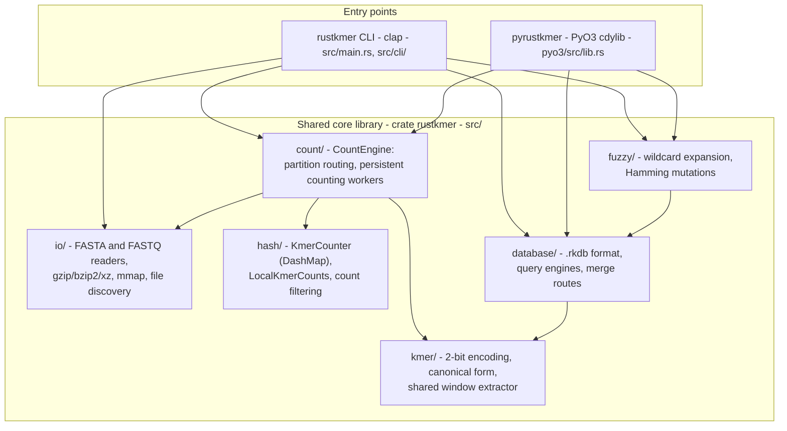
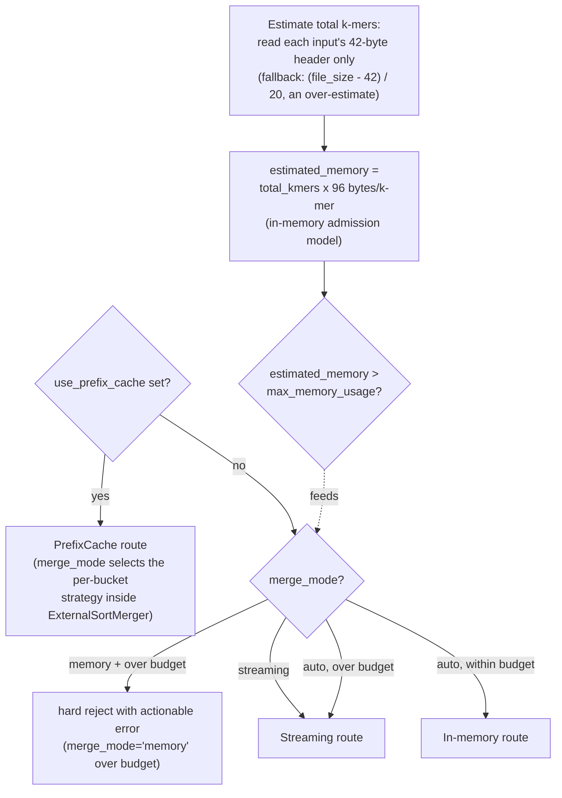

<!-- generated-by: gsd-doc-writer -->

# Architecture Overview

## System Overview

rustkmer is a high-performance toolkit for counting, querying, and merging DNA k-mers at genome scale. It is built as a single layered Rust library with two independent front ends that share it: a CLI binary (`rustkmer`, built from `src/main.rs` and `src/cli/` with clap) and a Python extension module (`pyrustkmer`, built from the separate PyO3 crate in `pyo3/`). Both front ends count through the same shared engine (`CountEngine` in `src/count/`), so counting semantics and per-key counts are identical across surfaces. All k-mer state is persisted in a custom fixed-layout binary format (`.rkdb`, magic `RKDB`, version 2), so both surfaces read and write the same databases. The architecture is a classic layered design — front ends over a domain core — with no server, daemon, or long-running state: every invocation is a pipeline step (count reads into a database, query/merge databases into results). Counting parallelizes over persistent OS worker threads that own disjoint hash-range partitions; rayon handles the final pair sort and the prefix-cache merge route.

## Component Diagram



The dependency direction is strictly downward: `src/cli/` and `pyo3/src/` depend on the core modules in `src/`, and the core modules never depend on a front end. The two front ends do not share business logic, with one deliberate exception: `pyo3/src/database.rs` calls `rustkmer::cli::commands::merge::parse_memory_size` so the Python `max_memory` grammar is byte-identical to the CLI's. `config/` is omitted from the dependency edges: it exposes `ConfigManager` as library API, but neither front end currently routes its settings through it. `CountEngine` is the one hot path both surfaces share verbatim — the CLI calls it from `execute_count`, and `PyCounter` calls it from every `add_from_fasta`/`add_from_fastq` before folding the result into its persistent counter. This is what lets a change to counting or merge logic benefit both surfaces at once.

## Entry Points

| Entry point | Location | Reached by |
|---|---|---|
| CLI binary | `src/main.rs` | Running `rustkmer <subcommand>` |
| Rust library | `src/lib.rs` | `use rustkmer::...` from the CLI binary, the PyO3 crate, and integration tests |
| Python module | `pyo3/src/lib.rs` | `import pyrustkmer` from Python |

- **CLI**: `src/main.rs` parses arguments (clap `Args::parse`), initializes `env_logger`, validates query arguments, and dispatches to one `execute_*` function per subcommand in `src/cli/commands/`. Subcommands (defined in `src/cli/args.rs`): `count`, `query`, `stats`, `dump`, `merge`, `fuzzy-query`, `fuzzy-query-batch`, `prefix-query`.
- **Library**: `src/lib.rs` re-exports the public modules (`count`, `database`, `fuzzy`, `hash`, `io`, `kmer`, among others) and the convenience types `KmerCounter`, `KmerError`, and `ProcessingResult`. The counting engine is reachable as `rustkmer::count::CountEngine`.
- **Python**: `pyo3/src/lib.rs` declares the `#[pymodule] fn pyrustkmer` and registers the `#[pyclass]` surface: `PyDatabase`, `PyDatabaseStats`, `PyQueryResult`, `PyPrefixQueryResult`, `LoadMode`, `PyCounter`, `PyCounterStats`, `PyFuzzyQuery`, `PyFuzzyResult`, `PyFuzzyMatch`, `PyPrefixQuery`, `PyExtendedPrefixQuery`, `PyPrefixQueryMetrics`, `PyFormatter`, and the `RustKmerError` exception type. The bindings live in a separate crate (`rustkmer-pyo3`, `pyo3/Cargo.toml`, built as a `cdylib`) that depends on the root `rustkmer` crate by path and is packaged as a wheel with maturin.

## Data Flow

### Count: FASTA/FASTQ to sorted `.rkdb`

The `count` command (`execute_count` in `src/cli/commands/count.rs`) turns sequence files into a `.rkdb` database in one pass through the shared `CountEngine`:

1. **Boundary validation** — the command rejects `--threads < 1`, missing input, and invalid filtering parameters; the engine itself rejects any `k` outside `1..=64` (two bits per base packed into a `u128`).
2. **Thread resolution** — the worker count is resolved once, before the file loop, from the precedence chain `--threads` > `RUSTKMER_THREADS` > `RAYON_NUM_THREADS` > `std::thread::available_parallelism()` (`resolve_thread_count` in `src/cli/commands/count.rs`). The command also attempts to configure the global rayon pool with that value once (used by the output sort and merge paths); if the pool is already initialized, the attempt is ignored. Counting itself is driven by the engine: `threads == 1` takes a sequential path on the caller thread with no workers, while `threads > 1` spawns exactly that many persistent OS threads named `rustkmer-count-{i}`.
3. **Input discovery** — either the explicit `-i` file list or directory discovery via `FileDiscovery` (`src/io/discovery.rs`).
4. **Format and compression routing** — each file is classified as FASTA or FASTQ (compression-aware extension detection plus a filename-substring fallback), validated, and opened through `DefaultCompressedFileReader` in `src/io/fastq.rs`, which transparently handles plain input, gzip (multi-member, via `MultiGzDecoder`), bzip2, and xz.
5. **Producer and window extraction** — a single producer reads and decompresses records sequentially with the strict `bio` readers and calls the one shared extractor, `for_each_window` (`src/kmer/extract.rs`), on each sequence. It uses `RollingEncoder` for `k <= 32` and `encode_kmer_bytes_u128` plus `canonical_kmer_u128` for `33..=64`. Any length-`k` window containing a non-ACGT byte is skipped and counted, never emitted, and no window spans a record boundary. Each emitted key is routed by `partition_of` (`src/count/partition.rs`) into exactly one partition; on the parallel path it is buffered and sent to that partition's owning worker in bounded batches (`DEFAULT_KEYS_PER_BATCH = 4096`, queue depth `DEFAULT_QUEUE_BATCHES = 8`), while the sequential path increments the partition table directly.
6. **Partition-local counting** — the engine fixes `partitions = clamp(threads, 64, 256)`. Each partition owns a disjoint `LocalKmerCounts` table (`src/hash/local.rs`): a `hashbrown::HashMap<u64, u32>` for `k <= 32` and `HashMap<u128, u32>` for `33..=64`, with the same overflow-checked per-key semantics as `KmerCounter`. No shared table, lock, or per-window atomic is touched while counting. At each file boundary on the parallel path the producer flushes its buffers and takes one acknowledgement per worker, and the per-partition totals are reduced with checked arithmetic, so a file's statistics are exact and aggregate overflow fails loudly rather than wrapping.
7. **Emit** — `engine.finish()` returns a `CountResult` whose partition tables are concatenated in layout order. Optional `--min-count`/`--max-count` filtering is applied as the pairs are drained (`CountResult::into_filtered_pairs`). Sorting is on by default (`--no-sort` is the opt-out): pairs are sorted by numeric encoded key with rayon's `par_sort_unstable_by`, which is also lexicographic decoded-sequence order and is required for binary-search queries. Binary output writes the canonical 42-byte `DatabaseHeader::write_to` followed by `KmerEntry::write_to` records (a 16-byte little-endian `u128` k-mer plus a 4-byte little-endian `u32` count), both from `src/database/format.rs`. Text output writes `sequence<TAB>count` lines in the same order. Because partition routing depends only on `(key, partition count)` and the sort removes layout order, the emitted bytes are independent of the thread count.

### Query

`DatabaseQuery::open(path, preload)` (`src/database/query.rs`) reads a `.rkdb` either by streaming entries through a `BufReader<File>` (binary search on sorted databases) or by preloading everything into a `Vec<KmerEntry>` cache (the CLI `--load` / `--no-load` flags). The fuzzy engine (`FuzzyQueryEngine`, `src/fuzzy/query.rs`) owns a fully loaded `RKDatabase` and expands `N` wildcards plus Hamming-distance mutation variants (`src/fuzzy/expansion.rs`, `src/fuzzy/mutation.rs`, `src/fuzzy/normalization.rs`); each generated variant is looked up with `RKDatabase::query_kmer` (falling back to its reverse complement), with `max_variants` guarding against combinatorial explosion. Prefix and hybrid-pattern lookups use the optimized extractors in `src/database/prefix_query_optimized.rs`.

### Merge: header-only size estimation and route selection

Both front ends — the CLI's `execute_merge` (`src/cli/commands/merge.rs`) and PyO3's `PyDatabase::merge` — funnel into `RKDatabase::merge_databases_to_path` (`src/database/format.rs`). It runs a prologue (empty-input guard, cross-input compatibility validation that reads only each input's 42-byte header, and a startup sweep of stale merge temp directories from `src/database/temp_lifecycle.rs`) and then resolves the merge route in `RKDatabase::resolve_merge_route`:



Key properties of the routing decision:

- **The estimator never loads data.** `RKDatabase::estimate_total_kmers` (`src/database/format.rs`) reads only the 42-byte header of each input via `read_header_of`. If the header is unreadable or reports `total_kmers == 0`, it falls back to a coarse over-estimate from the file size, `(file_size - 42) / 20` — over-estimating is the safe direction because it routes toward streaming rather than admitting an in-memory merge that could OOM. Per-input counts are summed with saturating addition.
- **The admission model is per-route.** `RKDatabase::estimated_bytes_for_route` charges the in-memory route 96 bytes per k-mer (`INMEMORY_BYTES_PER_KMER`, derived from the three 32-byte-per-element structures that route holds at peak). The streaming and prefix-cache figures (32 B/k-mer) are diagnostic only — those routes are bounded by chunk/bucket size, not by total k-mer count.
- **The budget defaults to half the machine.** `MergeConfig::max_memory_usage` (`src/database/merge_config.rs`) defaults to 50% of `MemTotal` (with a 32 GB fallback when that is unavailable) and is overridden by `--max-memory`.
- **Decision order is load-bearing.** `use_prefix_cache` returns early (its `merge_mode` selects the per-bucket strategy inside the external sorter, not the route); an explicit `merge_mode='memory'` that cannot fit the budget is rejected with an actionable error instead of being attempted; an explicit `merge_mode='streaming'` always streams; under `auto` (the default), over budget routes unconditionally to streaming and within budget takes the in-memory fast path.

The three routes (`MergeStrategy` in `src/database/merge_config.rs`):

| Route | Implementation | Behavior |
|---|---|---|
| `InMemory` | `src/database/format.rs` | Loads all inputs, accumulates counts in a `HashMap<u128, u32>`, writes the result once. The only route that ever holds the whole merged dataset. |
| `Streaming` | `ExternalMerger`, `DatabaseStreamIterator`, `TempFileManager` in `src/database/streaming_merge.rs` | External sort: inputs stream in chunks, sorted runs spill to temp files, and a `BinaryHeap` k-way merge emits `.rkdb` bytes directly to the destination as they are produced. |
| `PrefixCache` | `ExternalSortMerger` in `src/database/prefix_cache_merge.rs` | Shards k-mers into 256 prefix buckets and merges one bucket at a time, bounded by the per-bucket buffer, with per-bucket error isolation (a failed bucket keeps its shard files as the recovery path). |

All routes write their output directly to the destination path (the streaming route emits `.rkdb` bytes as the merge yields them; the prefix-cache route renames its finished file into place). Temporary files live in process-unique `rustkmer-merge-*` subdirectories owned by RAII `TempDir` handles, plus loose `rustkmer_sort_*` / `rustkmer_merge_*` chunk files written by the streaming writers. A startup sweep of stale paths (`src/database/temp_lifecycle.rs`) is the real defense for `panic = "abort"` / SIGKILL terminations where `Drop` never runs: it reclaims both old subdirectories and orphaned loose chunk files.

### Python API flow

`PyCounter` is a persistent `KmerCounter` wrapper. Each `add_from_fasta` / `add_from_fastq` call releases the GIL (`py.detach`), builds a fresh `CountEngine`, counts one file with the same extractor and parser the CLI uses, and folds the engine's partition tables into the shared counter with `CountResult::merge_into` (a checked, rayon-parallel reduction into the counter's `DashMap`). Counts therefore match the CLI exactly, including skip-N semantics. Database queries and merges go through `PyDatabase`, which provides its own preload, lazy, and `LoadMode::MemoryMapped` (direct file I/O) read modes over the same `.rkdb` format and calls the same `merge_databases_to_path` entry point as the CLI.

## Key Abstractions

| Abstraction | Location | Role |
|---|---|---|
| `CountEngine` / `EngineConfig` / `CountResult` | `src/count/engine.rs` | The shared counting pipeline: one producer extracts windows and routes keys, `threads == 1` counts on the caller thread, and `threads > 1` runs persistent per-worker pipelines over bounded channels. Owns file-boundary flush/ack statistics and exact checked sums. |
| `PartitionLayout` / `partition_of` / `LocalKmerCounts` | `src/count/partition.rs`, `src/hash/local.rs` | Hash-range partitioning (`P = clamp(threads, 64, 256)`, splitmix64 routing) and the disjoint per-partition tables. `LocalKmerCounts` uses dense `u64` keys for `k <= 32` and wide `u128` keys for `33..=64`, reproducing `KmerCounter`'s per-key overflow contract. |
| `for_each_window` | `src/kmer/extract.rs` | The one skip-N window extractor shared by the CLI and PyO3: emits every valid window of a record, skips non-ACGT windows, never spans records, and chooses the rolling encoder for `k <= 32` or the reference encoder for wider k. |
| `KmerCounter` / `CounterTable` | `src/hash/table.rs` | Persistent thread-safe counter over a sharded `dashmap::DashMap`; dense `u64` keys for `k <= 32`, wide `u128` keys for `33..=64`, `u128`-typed public surface, atomic per-key overflow-checked increments. Used directly by `PyCounter` and library consumers; `CountResult::merge_into` folds engine results into it. |
| `encode_kmer_bytes_u128` / `canonical_kmer_u128` | `src/kmer/encoding.rs`, `src/kmer/canonical.rs` | Bit-packing (2 bits per base, `A=00 C=01 G=10 T=11`) and strand normalization to `min(kmer, reverse_complement)`; k is capped at 64. |
| `DatabaseHeader` / `KmerEntry` / `RKDatabase` | `src/database/format.rs` | The `.rkdb` v2 on-disk format: magic `RKDB`, version 2, fixed 42-byte header (with `data_offset` pinned to 42), 20-byte little-endian entries; `RKDatabase` is the full in-memory representation and owns the merge routing. |
| `DatabaseQuery` | `src/database/query.rs` | Read-only query engine: streaming reads with binary search on sorted databases, or optional full preload into a `Vec<KmerEntry>` cache. |
| `MergeConfig` / `MergeStrategy` / route implementations | `src/database/merge_config.rs`, `streaming_merge.rs`, `prefix_cache_merge.rs` | Merge budget, temp directory, and route selector (`InMemory`, `Streaming`, `PrefixCache`; the enum also defines `Hybrid`, which the current dispatcher never returns). `ExternalMerger` implements the external-sort streaming route; `ExternalSortMerger` implements the 256-bucket prefix-cache route. |
| Prefix query engine | `src/database/prefix_query_optimized.rs`, `src/database/prefix_query.rs` | Optimized prefix and hybrid-pattern extraction over sorted databases, used by the CLI `prefix-query` command and the PyO3 `PyPrefixQuery` / `PyExtendedPrefixQuery` classes; the non-optimized `prefix_query` module provides `extract_kmers_by_prefix`, which `src/database/suffix_query.rs` builds on. |
| `FuzzyQuery` / `FuzzyQueryEngine` | `src/fuzzy/query.rs` | Builder-style fuzzy query config plus the engine that expands wildcard/mutation variants and performs exact lookups against a loaded `RKDatabase`, with combinatorial-explosion limits. |
| `KmerError` / `ProcessingError` / `ProcessingResult` | `src/error.rs` | Layered error taxonomy: library code returns `Result<T, KmerError>` / `ProcessingResult<T>`, the CLI converts via `anyhow`, and PyO3 bridges to Python exceptions. |
| `ConfigManager` | `src/config/manager.rs` | Layered configuration API — `.rustkmerrc` file, `RUSTKMER_*` environment variables, and per-operation overrides — behind a `parking_lot::RwLock`. Exported by the library; the current CLI and PyO3 commands read their environment settings directly rather than routing through it. |
| PyO3 wrappers | `pyo3/src/database.rs`, `pyo3/src/counter.rs`, `pyo3/src/fuzzy_query.rs`, `pyo3/src/prefix_query.rs`, `pyo3/src/formatter.rs`, `pyo3/src/errors.rs` | Thin `#[pyclass]` adapters over the core types; errors surface as standard Python exceptions (`PyValueError`, `PyRuntimeError`, `PyFileNotFoundError`, `PyPermissionError`); the registered `RustKmerError` class is defined and exported but never raised. |

## Directory Structure

```text
src/
├── main.rs          # CLI entry point (binary crate)
├── lib.rs           # Library root; re-exports public modules and key types
├── error.rs         # Error taxonomy (KmerError, ProcessingError, ProcessingResult)
├── cli/             # clap argument tree (args.rs) + one execute_* per subcommand (commands/)
├── count/           # shared counting engine: partition routing, persistent counting workers
├── kmer/            # encoding, canonical form, window extraction, validation, operations
├── hash/            # KmerCounter, LocalKmerCounts, count filtering, overflow protection
├── io/              # FASTA/FASTQ parsing, compression, memory mapping, file discovery
├── database/        # .rkdb format, query engines (streaming, prefix/suffix), merge subsystem
├── fuzzy/           # wildcard expansion, mutation enumeration, normalization
├── config/          # layered configuration API (file + environment + per-operation overrides)
├── core/            # metadata persistence (database/ submodule), performance monitoring
├── memory/          # memory-efficiency helpers
└── output/          # output formatting (binary, text)

pyo3/
├── Cargo.toml       # crate rustkmer-pyo3 (cdylib), path dependency on the root crate
├── pyproject.toml   # maturin build backend, pytest/tooling configuration
├── src/             # PyO3 wrappers exposing the pyrustkmer module
└── tests/           # Python tests for the bindings
```

The split is intentional: everything under `src/` (minus `src/cli/`) is front-end-agnostic domain logic; `src/count/` holds the counting hot loop and worker pipeline that both front ends call; `src/cli/` holds only argument parsing, validation, and output formatting for the terminal; `pyo3/` holds only the Python binding shim. The database subsystem is the largest module because persistence, query, and three merge strategies all live beside the format definition they share.

## Architectural Constraints and Invariants

- **K-mer width**: `k` is hard-bounded to `1..=64` (two bits per base in a `u128`), enforced by `CountEngine::new` and by `KmerCounter::new`. The dense/wide table choice is purely an in-RAM optimization — `.rkdb` files always store 16-byte `u128` k-mers regardless of `k`.
- **Determinism**: partition routing depends only on `(key, partition count)`, and per-key counts never depend on which worker or how many workers ran. With sorting enabled (the default), the emitted `.rkdb` bytes are therefore identical across thread counts; unsorted output order can vary with the partition count.
- **Single-process, no coordination**: there is no server, IPC, or file locking. All shared state is instance-scoped (`KmerCounter`'s sharded map, `DatabaseQuery`'s optional cache); concurrent writers to the same `.rkdb` path will corrupt it.
- **Format discipline**: `.rkdb` is version 2 with a fixed 42-byte header and 20-byte entries; readers reject any `data_offset` other than 42 rather than silently clamping it. The header's `total_kmers` is a record count, not a sum of counts.
- **Parallelism**: counting uses exactly the resolved worker count. A single thread runs the sequential engine path with no queues; more than one thread starts that many persistent OS threads (`rustkmer-count-{i}`), each owning a disjoint range of 64–256 hash-range partitions and fed by its own bounded channel. Counting workers never run as rayon tasks (a blocking `recv` there could starve the pool). Rayon remains in use for the output pair sort, the `PyCounter` merge bridge, and the prefix-cache merge. Decompression and parsing stay single-threaded by design.
- **Memory safety on merge**: the merge admission model exists so that an over-budget merge routes to a bounded route or fails with an actionable error — never attempts an in-memory merge that would OOM — and the estimator itself reads only headers so it can never be the OOM.
- **Counting exactness**: per-key counts keep the `u32` overflow contract, and every aggregate total (per-file statistics, flush, finish) is summed with checked arithmetic that fails loudly on `u64` overflow instead of wrapping or saturating.

## Related Documentation

- [API Reference Overview](../api-reference/overview.md) — the `pyrustkmer` class surface
- [Core Concepts](../user-guide/concepts.md) — k-mers, canonical form, and database basics
- [Prefix Query Guide](../guides/prefix-query-guide.md) — hybrid prefix patterns
- [PyO3 Binding Guide](../guides/pyo3-binding-guide.md) — building and extending the Python module
